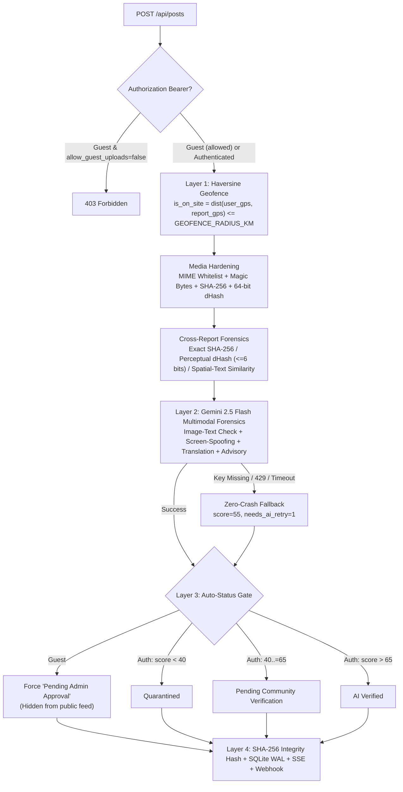

# CivicPulse-Backend (`feat/civicpulse-backend`)

**CivicPulse** is a Zero-Fake AI Community Crisis, Nature & Eco-Tourism Safety Network built with **Rust**, **Axum 0.8**, **Tokio**, **SQLite WAL (`r2d2_sqlite` + FTS5)**, **Argon2id**, and **Google Gemini 2.5 Flash**.

> **සිංහල සාරාංශය:** CivicPulse යනු හදිසි ආපදා, පාරිසරික වෙනස්කම්, සහ සංචාරක ආරක්ෂාව පිළිබඳ සජීවී (Real-time) තොරතුරු ප්‍රජාව හරහා බෙදාගන්නා, ව්‍යාජ පුවත් ස්වයංක්‍රීයව හඳුනාගෙන වළක්වන (Zero-Fake) AI ප්‍රජා ආරක්ෂණ ජාලයයි. මෙම `./CivicPulse-Backend` සේවාව `./CivicPulse-Frontend` (Next.js Web App) සහ `./CivicPulse-CLI` (Emergency Responder CLI) සඳහා සම්පූර්ණ production REST API + SSE + GeoJSON + Analytics එන්ජිම සපයයි.

---

## Who Uses CivicPulse

- **Local Communities:** Share and verify floods, landslides, road blocks, and infrastructure hazards with GPS geofencing and crowd consensus.
- **Eco-Tourists & Hikers:** Check live trail weather, coastal swells, and localized safety advisories (`Safe` | `Caution` | `Danger`) translated automatically into English from Sinhala, Tamil, or other languages.
- **Emergency Responders & NGOs:** Consume tamper-verified alerts, geospatial hazard clusters, corridor route risk scores, HMAC-signed emergency webhooks, and RFC 7946 GeoJSON feeds.

---

## 4-Layer Zero-Fake Trust Engine

Every incoming report (`POST /api/posts`) passes through a deterministic 4-layer verification pipeline before being persisted:



### Layer Breakdown
1. **Layer 1 — Haversine Geofencing (`src/services/geofence.rs`):** Computes spherical Earth distance (`R = 6371.0 km`) between reporter GPS (`user_lat`, `user_lng`) and incident coordinates (`lat`, `lng`), flagging `is_on_site = true` when distance `<= GEOFENCE_RADIUS_KM` (`15.0 km` default).
2. **Layer 2 — Gemini 2.5 Flash Multimodal Forensics & Translation (`src/services/gemini.rs`):**
   - Evaluates image-text consistency, screen-spoofing cues (bezel glare, moiré patterns, stock mismatch), and cross-report duplicate alerts.
   - Translates Sinhala/Tamil/non-English descriptions into clear English `translated_description` and assigns `travel_advisory` (`Safe` | `Caution` | `Danger`) and `severity` (`1..=10`).
   - **Zero-Crash Fallback + Auto-Retry:** Missing keys, timeouts, malformed JSON, or HTTP `429` never crash the server — reports safely fall back to `ai_authenticity_score: 55` (`Pending Community Verification`) and are queued (`needs_ai_retry = 1`) for the background AI Retry Worker (`src/services/workers.rs`) when a Gemini key is configured.
3. **Layer 3 — Auto-Status, Weighted Crowd Quorum & Guest Moderation (`src/services/trust_engine.rs`, `src/routes/admin.rs`):**
   - `score < 40` -> `Quarantined` | `40..=65` -> `Pending Community Verification` | `> 65` -> `AI Verified`.
   - **Verify (`POST /api/posts/:id/verify`):** Adds `+1` confirmation (`+2` weight for Admins or users with `reputation_score >= 50`). Reaching `>= 3` confirmations promotes the post to `Community Verified` and awards `+5` reputation to the author.
   - **Flag (`POST /api/posts/:id/flag`):** Increments `false_flags`. At `>= 3` flags, if `is_live_captured && ai_authenticity_score > 80`, transitions to `Disputed` (anti-brigading guard); otherwise transitions to `Quarantined` (`-5` author reputation).
   - **Guest Uploads:** When `allow_guest_uploads = true`, guest submissions still run through the Gemini Trust Engine but are held in `Pending Admin Approval` (hidden from public feeds, AI chat, analytics, and GeoJSON) until an Admin calls `approve` or `reject`.
4. **Layer 4 — Cryptographic Integrity (`src/services/integrity.rs`):** Computes a canonical SHA-256 hex digest over `title|description|lat|lng|created_at`, verifiable anytime at `GET /api/posts/:id/verify-integrity`.

---

## Advanced Algorithms & Production Security

- **Dynamic Geospatial & Crisis Algorithms (`src/services/algorithms.rs`):**
  - **Exponential Time-Decay Priority Ranking (`sort=priority`):** Ranks reports (`0.0..=100.0`) using severity, verification trust multiplier, travel advisory weight, live/on-site telemetry, quorum bonus, resolution damping (`0.25x`), and an 18-hour half-life decay curve.
  - **DBSCAN-Style Hazard Hotspot Clustering (`GET /api/analytics/hotspots`):** Clusters active unresolved non-quarantined hazards within `cluster_radius_km`, returning severity-weighted centroids, cluster radii, and risk indices (`0–100`).
  - **Spherical Corridor Route Safety (`POST /api/analytics/route-safety`):** Computes shortest point-to-segment distance from active hazards along multi-waypoint travel legs within `corridor_km`.
  - **Cross-Report Spoof Detection:** Combines SHA-256 byte matching, **64-bit Perceptual `dHash`** (`src/services/media.rs`, detecting resized/recompressed/screenshot duplicates within Hamming distance `<= 6`), and Token Jaccard + Character Trigram Dice text similarity (`>= 0.65` within `3.0 km`).
- **Media Hardening & Disk Storage (`src/services/media.rs`, `src/routes/uploads.rs`):**
  - Validates MIME whitelist + actual binary magic bytes (`JPEG`, `PNG`, `WebP`, `GIF`, `HEIC/MP4/MOV`, `WebM`) to block SVG/script spoofing.
  - Atomic disk persistence in `UPLOAD_DIR` (`MEDIA_STORAGE_MODE=file`) served at `GET /uploads/{filename}` with path-traversal protection and immutable cache headers.
- **Auth, Rate Limiting & OWASP Hardening:**
  - **Persistent Argon2id + SQLite Sessions (`src/services/auth.rs`):** Random-salt Argon2id password hashes, `SHA-256` hashed expiring Bearer tokens (`SESSION_TTL_HOURS`), `POST /api/auth/logout`, and `POST /api/auth/change-password` (revokes other sessions).
  - **Two-Tier Sliding-Window Rate Limiting (`src/middleware/rate_limit.rs`):** Global per-IP `POST` limit (`RATE_LIMIT_POST_PER_MIN`, `10/min` default) plus strict Auth brute-force limit (`AUTH_RATE_LIMIT_PER_15MIN`, `15/15min` default). Respects `X-Forwarded-For` / `X-Real-IP` **only** when `TRUST_PROXY_HEADERS=true`.
  - **Anti-Sybil Unique Voters (`STRICT_UNIQUE_VOTERS`):** Persists `post_votes` to reject duplicate verify/flag votes (`409 Conflict`).
  - **Text Sanitization & Security Headers (`src/middleware/security.rs`):** Strips ANSI terminal escapes, NUL bytes, and Unicode Bidi overrides; injects `X-Request-Id`, `X-Content-Type-Options: nosniff`, `X-Frame-Options: DENY`, `Referrer-Policy: no-referrer`, `Permissions-Policy`, and `Cache-Control: no-store`.
- **Real-Time & Responder Integrations:**
  - **Server-Sent Events (`GET /api/events`):** Broadcasts live `post_created`, `post_verified`, `post_flagged`, `post_resolved`, `comment_added`, `post_approved`, `post_rejected`, and `post_ai_updated` events.
  - **HMAC-SHA256 Signed Webhooks (`src/services/webhook.rs`):** Sends async `X-CivicPulse-Signature: sha256=<hex>` alerts to `WEBHOOK_URL` for verified `Danger` reports with `severity >= 8`.
  - **Observability & OpenAPI (`src/middleware/metrics.rs`, `src/routes/docs.rs`):** Exposes Prometheus `0.0.4` `/metrics`, `/openapi.json` (OpenAPI 3.1), and Swagger UI `/docs`.

---

## Database & Seed Dataset

- **Engine:** Pooled SQLite WAL (`r2d2` + `r2d2_sqlite`, `PRAGMA journal_mode = WAL`, `PRAGMA foreign_keys = ON`, `PRAGMA busy_timeout = 5000`) with versioned migrations tracked in `schema_migrations` (`v1`–`v3`).
- **Tables:** `posts`, `comments`, `post_votes`, `audit_logs`, `users`, `sessions`, `system_settings`, and virtual FTS5 table `posts_fts` (paired with UTF-8 substring fallback for Sinhala/Tamil queries).
- **Pre-Populated Seed Reports (`src/seed.rs`, 6 realistic incidents with verified SHA-256 hashes & comments):**
  1. **Ella Rock Trail Ridge Mist & Slippery Ascent** (`Tourism`, `6.8667, 81.0466`) — `Caution`, severity `5`, `Community Verified`
  2. **Nuwara Eliya Landslide Alert on Hatton A7 Slope** (`Disaster`, `6.9497, 80.7891`) — Sinhala original + English translation, `Danger`, severity `9`, `Community Verified`
  3. **Galle Coastal Swell & Rip Current Warning** (`Nature`, `6.0267, 80.2170`) — `Caution`, severity `7`, `AI Verified`
  4. **Sinharaja Rain Advisory & Rising Forest Streams** (`Nature`, `6.4050, 80.4600`) — `Caution`, severity `6`, `AI Verified`
  5. **Gampaha Road Flood Near Attanagalu Oya** (`Road`, `7.0873, 79.9990`) — Sinhala original + English translation, `Danger`, severity `8`, `Pending Community Verification` (`confirmations: 2`)
  6. **Mount Fuji Trail Status — Yoshida 5th Station Clear** (`Tourism`, `35.3606, 138.7274`) — `Safe`, severity `2`, `Community Verified`

---

## Directory Structure

```text
CivicPulse-Backend/
├── .env.example                 # Complete zero-hardcoding runtime configuration template
├── .gitignore
├── API_CONTRACT.md              # Detailed request/response contract for ./CivicPulse-Frontend & ./CivicPulse-CLI teams
├── Cargo.toml
├── Dockerfile                   # Multi-stage production container build
├── README.md
├── src/
│   ├── main.rs                  # Bootstrap, pooled DB init, background workers, graceful shutdown
│   ├── lib.rs                   # App builder, migrations, seeding, persistent state initialization
│   ├── config.rs                # Env-driven Config parser with safe defaults
│   ├── error.rs                 # Unified AppError -> structured JSON HTTP responses
│   ├── models.rs                # Post, Comment, Enums, Query/DTOs, GeoJSON & Event schemas
│   ├── state.rs                 # Shared AppState (repo, Gemini, rate limiters, auth, SSE, metrics)
│   ├── db.rs                    # r2d2 SQLite WAL repository, migrations v1-v3, FTS5, audit logs
│   ├── seed.rs                  # 6 realistic Sri Lankan & global seed reports
│   ├── middleware/
│   │   ├── mod.rs
│   │   ├── metrics.rs           # Atomic Prometheus counters & /metrics endpoint
│   │   ├── rate_limit.rs        # Sliding-window IP rate limiter + trusted-proxy extraction
│   │   └── security.rs          # ANSI/Bidi text sanitization + OWASP security headers
│   ├── services/
│   │   ├── mod.rs
│   │   ├── algorithms.rs        # Priority decay, DBSCAN hotspots, route corridor safety, similarity
│   │   ├── auth.rs              # Argon2id hashing & SQLite expiring session management
│   │   ├── gemini.rs            # Gemini 2.5 Flash forensics, translation, chat & 429 fallback
│   │   ├── geofence.rs          # WGS84 validation & Haversine distance calculation
│   │   ├── integrity.rs         # Canonical SHA-256 hashing & constant-time verification
│   │   ├── media.rs             # 64-bit perceptual dHash & atomic disk upload storage
│   │   ├── trust_engine.rs      # 4-Layer Trust Engine orchestration & quorum state rules
│   │   ├── webhook.rs           # RFC 2104 HMAC-SHA256 signed emergency webhooks
│   │   └── workers.rs           # Periodic AI 429 retry & expired session cleanup workers
│   └── routes/
│       ├── mod.rs               # Router assembly, configurable CORS & body limit
│       ├── admin.rs             # Guest upload policy & Admin approve/reject/pending endpoints
│       ├── ai.rs                # POST /api/ai/chat
│       ├── analytics.rs         # Hotspot clustering & route safety endpoints
│       ├── auth.rs              # Register, login, logout, /me, change-password
│       ├── docs.rs              # /openapi.json & Swagger UI /docs
│       ├── events.rs            # Real-time SSE /api/events stream
│       ├── export.rs            # RFC 7946 GeoJSON export
│       ├── posts.rs             # CRUD, verify, flag, resolve, comment, integrity & audit logs
│       └── uploads.rs           # Safe media serving at /uploads/{filename}
└── tests/
    └── api_integration.rs       # End-to-end integration tests across all layers & endpoints
```

---

## REST API Overview

Full JSON schemas and header specifications are in [`API_CONTRACT.md`](./API_CONTRACT.md).

| Group | Method & Path | Access | Description |
| :--- | :--- | :--- | :--- |
| **System** | `GET /health` | Public | Health check, post count, Gemini & guest-upload status |
| | `GET /metrics` | Public | Prometheus `0.0.4` metrics exposition |
| | `GET /openapi.json` / `GET /docs` | Public | OpenAPI 3.1 spec & Swagger UI |
| | `GET /api/events` | Public | Server-Sent Events live stream |
| | `GET /uploads/:filename` | Public | Serve disk-stored media uploads |
| **Auth** | `POST /api/auth/register` | Public | Register `user` account -> `{ token, role, name, email, reputation_score, expires_at }` |
| | `POST /api/auth/login` | Public | Authenticate seeded/registered user or admin |
| | `POST /api/auth/logout` | Bearer | Revoke current session in SQLite |
| | `GET /api/auth/me` | Bearer | Inspect active session & reputation |
| | `POST /api/auth/change-password` | Bearer | Update Argon2id password & revoke other sessions |
| **Admin** | `GET /api/admin/settings` | Admin | Read persisted `allow_guest_uploads` policy |
| | `POST /api/admin/settings` | Admin | Toggle & persist `allow_guest_uploads` |
| | `GET /api/admin/pending` | Admin | List `Pending Admin Approval`, `Quarantined`, and `Disputed` posts |
| | `POST /api/admin/posts/:id/approve` | Admin | Set status to `Admin Approved` (makes public) |
| | `POST /api/admin/posts/:id/reject` | Admin | Set status to `Rejected` (hides from public & pending) |
| **Posts** | `GET /api/posts` | Public | Filter (`category`, `verified_only`, `search`, `exclude_quarantined`, `lat`/`lng`/`radius_km`), `sort` (`newest`\|`priority`\|`nearest`\|`severity`), paginate (`limit`, `offset`, `X-Total-Count`) |
| | `POST /api/posts` | Guest / Bearer | Submit incident through 4-Layer Zero-Fake Trust Engine |
| | `GET /api/posts/:id` | Public | Fetch single post by ID |
| | `GET /api/posts/:id/verify-integrity` | Public | Recompute & verify SHA-256 integrity hash |
| | `GET /api/posts/:id/audit` | Public | Immutable audit log entries for post |
| | `POST /api/posts/:id/verify` | Public / Bearer | Weighted community confirmation (`>= 3` -> `Community Verified`) |
| | `POST /api/posts/:id/flag` | Public / Bearer | Flag false info (`>= 3` -> `Disputed` if live & score > 80, else `Quarantined`) |
| | `POST /api/posts/:id/resolve` | Public | Toggle `is_resolved` |
| | `POST /api/posts/:id/comment` | Public | Append comment (`author` optional) |
| **AI & GIS** | `POST /api/ai/chat` | Public | Real-time Gemini tactical chat injected with all active non-quarantined posts |
| | `GET /api/export/geojson` | Public | Valid RFC 7946 `FeatureCollection` (`[lng, lat]` coordinates) |
| | `GET /api/analytics/hotspots` | Public | DBSCAN hazard cluster summary |
| | `POST /api/analytics/route-safety` | Public | Multi-waypoint corridor hazard check |

---

## Environment Configuration (`.env`)

All runtime behavior is configurable via environment variables (see [`.env.example`](./.env.example)):

| Variable | Default | Purpose |
| :--- | :--- | :--- |
| `HOST` / `PORT` | `0.0.0.0` / `8080` | Bind address and HTTP port |
| `ALLOWED_ORIGINS` | *(empty = permissive)* | Comma-separated CORS origin allowlist for production |
| `TRUST_PROXY_HEADERS` | `false` | Set `true` only behind a trusted reverse proxy (Nginx/Cloudflare/Cloud Run) |
| `DATABASE_PATH` / `DB_POOL_SIZE` | `./data/civicpulse.db` / `8` | SQLite WAL file path & `r2d2` connection pool size (`1..=64`) |
| `SEED_INITIAL_POSTS` | `true` | Seed the 6 initial reports when `posts` table is empty |
| `MEDIA_STORAGE_MODE` / `UPLOAD_DIR` | `file` / `./data/uploads` | `file` stores media on disk (`/uploads/...`); `inline` keeps base64 data URIs |
| `PUBLIC_BASE_URL` | *(empty)* | Optional public origin prefix for returned `/uploads/...` URLs |
| `MAX_BODY_SIZE_BYTES` / `MAX_DECODED_MEDIA_BYTES` | `15728640` / `12582912` | Max HTTP upload size (`15 MB`) & decoded media cap (`12 MB`) |
| `GEMINI_API_KEY` | *(optional)* | Google AI Studio key for Gemini 2.5 Flash forensics & chat |
| `GEMINI_ENDPOINT` / `GEMINI_TIMEOUT_SECS` | `...gemini-2.5-flash:generateContent` / `20` | Gemini endpoint & HTTP timeout |
| `AI_RETRY_INTERVAL_SECS` | `60` | Background retry sweep interval for deferred `429`/timeout posts |
| `GEOFENCE_RADIUS_KM` | `15.0` | Layer 1 on-site GPS geofence threshold (km) |
| `RATE_LIMIT_POST_PER_MIN` / `AUTH_RATE_LIMIT_PER_15MIN` | `10` / `15` | Global `POST` rate limit (1m) & Auth brute-force limit (15m) |
| `STRICT_UNIQUE_VOTERS` | `false` (`true` in Docker) | Enforce 1 verify/flag vote per user/client/IP |
| `SESSION_TTL_HOURS` / `ALLOW_GUEST_UPLOADS_DEFAULT` | `24` / `true` | Bearer token lifetime & initial guest-upload setting |
| `ADMIN_SEED_EMAIL` / `ADMIN_SEED_PASSWORD` / `ADMIN_SEED_NAME` | `admin@civicpulse.org` / `admin123` / `CivicPulse Admin` | Initial Admin account seeded if missing |
| `USER_SEED_EMAIL` / `USER_SEED_PASSWORD` / `USER_SEED_NAME` | `user@civicpulse.org` / `user123` / `CivicPulse Reporter` | Initial User account seeded if missing |
| `WEBHOOK_URL` / `WEBHOOK_SECRET` | *(empty)* | Optional endpoint & HMAC-SHA256 secret for verified `Danger` (`severity >= 8`) alerts |
| `STALE_ALERT_HOURS` | `72` | Configured stale alert horizon (hours) |
| `RUST_LOG` | `civicpulse_backend=info,tower_http=info` | Tracing log filter |

---

## Quickstart

### 1. Local Development
```bash
cd ./CivicPulse-Backend
cp .env.example .env
# Edit .env and set your real GEMINI_API_KEY (and override ADMIN_SEED_PASSWORD for production)
cargo run
```
The API starts at `http://localhost:8080` (Swagger UI at `http://localhost:8080/docs`, Prometheus metrics at `http://localhost:8080/metrics`).

### 2. Run Tests & Linter
```bash
cd ./CivicPulse-Backend
cargo test
cargo clippy --all-targets -- -D warnings
```

### 3. Docker Production Run
```bash
cd ./CivicPulse-Backend
docker build -t civicpulse-backend .
docker run -d \
  --name civicpulse-backend \
  -p 8080:8080 \
  -v civicpulse_data:/app/data \
  -e GEMINI_API_KEY="your_real_key" \
  -e ADMIN_SEED_PASSWORD="strong_admin_password" \
  -e ALLOWED_ORIGINS="https://your-frontend.example.com" \
  civicpulse-backend
```

### 4. Quick Smoke `curl` Commands
```bash
# 1. Health check
curl -s http://localhost:8080/health

# 2. Login as Admin
TOKEN=$(curl -s -X POST http://localhost:8080/api/auth/login \
  -H "Content-Type: application/json" \
  -d '{"email":"admin@civicpulse.org","password":"admin123"}' | jq -r .token)

# 3. Submit an authenticated report
curl -s -X POST http://localhost:8080/api/posts \
  -H "Content-Type: application/json" \
  -H "Authorization: Bearer $TOKEN" \
  -d '{"user_lat":6.8660,"user_lng":81.0460,"lat":6.8667,"lng":81.0466,"title":"Ella Trail Fog","description":"Heavy mist near ridge","category":"Tourism","location_name":"Ella Rock","is_live_captured":true}'

# 4. Priority-sorted public feed & GeoJSON export
curl -s "http://localhost:8080/api/posts?sort=priority&limit=10"
curl -s "http://localhost:8080/api/export/geojson?verified_only=true"
```
