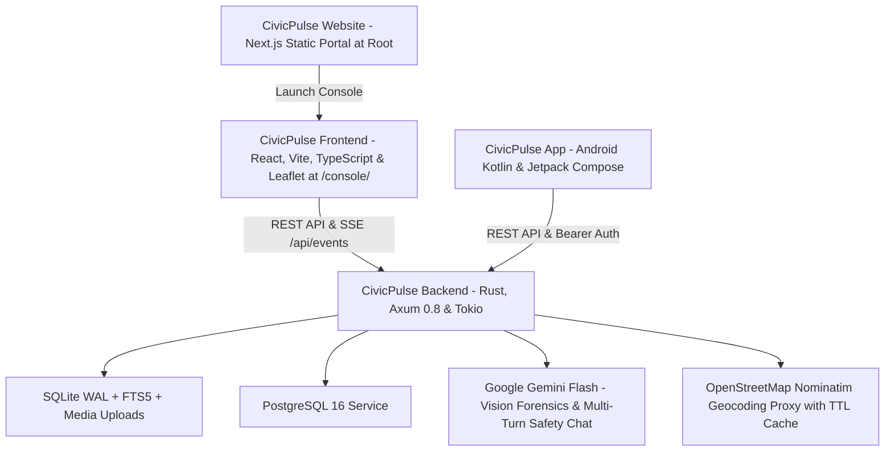

<div align="center">

<!-- Animated Waving Hero Header -->


<!-- Animated Typing Tagline -->
<a href="https://bihindubulanjay.github.io/CivicPulse-Project/">
  
</a>

<br />

<!-- Live Hosted Links & CI Status -->
<p>
  <a href="https://bihindubulanjay.github.io/CivicPulse-Project/">
    
  </a>
  <a href="https://bihindubulanjay.github.io/CivicPulse-Project/console/">
    
  </a>
  <a href="https://github.com/bihindubulanjay/CivicPulse-Project/actions/workflows/deploy-pages.yml">
    
  </a>
  <a href="LICENSE">
    
  </a>
</p>

<!-- Technology Stack Badges -->
<p>
  
  
  
  
  
  
</p>

</div>

---

> **CivicPulse** is a real-time, community-first crisis, infrastructure, nature, and eco-tourism safety platform built to eliminate fake panic through cryptographic integrity, geofenced `LIVE REC` capture, multimodal Gemini forensics, and anti-sybil crowd verification.
>
> **සිංහලෙන්:** CivicPulse යනු ප්‍රජාව විසින් වාර්තා කරන ආපදා, මාර්ග හා යටිතල පහසුකම් ගැටලු, පාරිසරික වෙනස්කම් සහ සංචාරක ආරක්ෂක අවදානම් සත්‍යාපනය කර සජීවී සිතියමක් හරහා බෙදාගැනීමට උපකාරී වන විවෘත මූලාශ්‍ර වේදිකාවකි.

---

## Live Hosted Deployments

| Surface | URL | Purpose |
| :--- | :--- | :--- |
| **Public Safety Website** | **https://bihindubulanjay.github.io/CivicPulse-Project/** | Next.js landing experience showcasing disaster VFX telemetry, trust engine architecture, and safety overview |
| **Live Interactive Console** | **https://bihindubulanjay.github.io/CivicPulse-Project/console/** | React + Leaflet operational map, live incident feed, camera capture, Gemini Safety Chat, and Admin moderation console |
| **GitHub Pages Pipeline** | [`deploy-pages.yml`](.github/workflows/deploy-pages.yml) | Automated dual-build workflow exporting Website (`/`) and Console (`/console/`) to GitHub Pages |

---

## 4-Layer Zero-Fake Trust Engine

Every incident submitted to CivicPulse passes through a multi-stage verification pipeline designed to surface genuine local alerts while automatically quarantining manipulated, recycled, or spoofed reports:

| Layer | Mechanism | Enforcement & Guarantees |
| :---: | :--- | :--- |
| **Layer 1** | **Physical & Cryptographic Capture** | In-browser `LIVE REC` camera capture (`is_live_captured`), 15 km GPS geofence attestation (`is_on_site`), binary magic-byte inspection (blocks disguised scripts/SVG XSS), and perceptual `dHash` + exact SHA-256 duplicate media matching. |
| **Layer 2** | **Google Gemini Multimodal Forensics** | Evaluates photo-text consistency and screen-spoofing cues (`0–100` authenticity score), translates Sinhala/Tamil descriptions to English, classifies travel advisory (`Safe` / `Caution` / `Danger`), assigns severity (`1–10`), and automatically retries across configured fallback Gemini endpoints. |
| **Layer 3** | **Anti-Sybil Community Quorum** | Database-enforced unique voter constraint (`1` vote per voter per report), blocks self-voting on own reports, requires community confirmations/flags to promote or dispute reports, and preserves strict admin moderation decisions (`Approved` / `Rejected` / `Quarantined`). |
| **Layer 4** | **Immutable Integrity & Real-Time Alerts** | Computes tamper-evident SHA-256 integrity hashes (`/api/posts/{id}/verify-integrity`), appends lifecycle audit logs, streams live Server-Sent Events (`/api/events`), and dispatches optional HMAC-SHA256 signed emergency webhooks for high-severity `Danger` alerts. |

---

## System Architecture



---

## Multi-Platform Workspace

| Module | Stack | Highlights | Location |
| :--- | :--- | :--- | :--- |
| **Backend API** | Rust, Axum 0.8, Tokio, Argon2id, SQLite WAL | 4-Layer Trust Engine, Role Auth (`admin`/`user`), Nominatim Search & Reverse Geocode, GeoJSON export, Prometheus `/metrics`, OpenAPI `/docs` | [`CivicPulse-Backend/`](CivicPulse-Backend/README.md) |
| **Operational Console** | React 18, Vite, TypeScript, Tailwind CSS, Leaflet | Split Map/Feed workspace, Live GPS tracking, `LIVE REC` camera modal, Offline `localStorage` queue with auto-sync, Multi-Turn Gemini Advisor, Admin Console | [`CivicPulse-Frontend/`](CivicPulse-Frontend/) |
| **Public Website** | Next.js, React, Tailwind CSS (`output: 'export'`) | Interactive Canvas VFX preloader, Thermal FLIR visual mode, Trust Engine walkthrough, Sri Lanka emergency quick links | [`CivicPulse-Website/`](CivicPulse-Website/README.md) |
| **Mobile Client** | Android, Kotlin 2.0, Jetpack Compose, Material 3 | Live feed priority sorting, camera photo attestation, Fused Location GPS reporting, dark-mode Gemini safety chat | [`CivicPulse-App/`](CivicPulse-App/README.md) |

---

<details>
<summary><strong>Quick Start — Local Development & Docker Compose</strong></summary>

### 1. Clone & Configure Environment

```bash
git clone https://github.com/bihindubulanjay/CivicPulse-Project.git
cd CivicPulse-Project
cp .env.example .env
```

Update `.env` with a strong `POSTGRES_PASSWORD` and your `GEMINI_API_KEY` (never commit `.env` or real credentials).

### 2. Run Backend + PostgreSQL via Docker Compose

```bash
docker compose up --build
```

- Backend API: `http://localhost:8080`
- Health Check: `GET http://localhost:8080/health`
- Interactive Swagger / OpenAPI Docs: `http://localhost:8080/docs`

### 3. Run the Operational Web Console (Port `3001`)

```bash
cd CivicPulse-Frontend
npm install
cp .env.example .env
npm run dev
```

### 4. Run the Public Website

```bash
cd CivicPulse-Website
npm install
npm run dev
```

### 5. Run Backend Locally Without Docker

```bash
cd CivicPulse-Backend
cp .env.example .env
cargo test
cargo run --bin civicpulse-backend
```

</details>

<details>
<summary><strong>Core API Endpoints & Real-Time Streams</strong></summary>

For full schemas and headers, see [`CivicPulse-Backend/API_CONTRACT.md`](CivicPulse-Backend/API_CONTRACT.md).

| Method & Path | Access | Purpose |
| :--- | :--- | :--- |
| `GET /health` | Public | Backend health, DB post count, guest policy, and active Gemini model status |
| `GET /api/events` | Public | Real-time Server-Sent Events stream (`post_created`, `post_verified`, `post_flagged`, `post_resolved`, `admin_queue_updated`) |
| `GET /api/posts` / `POST /api/posts` | Public / Policy-guarded | Filter/sort posts (`priority`, `nearest`, `severity`, `newest`) and submit verified/camera-captured incidents |
| `POST /api/posts/{id}/verify` & `/flag` | Unique Voter | Anti-sybil single-vote confirmation or dispute flagging |
| `POST /api/posts/{id}/resolve` & `/comment` | Author / Admin / Public | Mark incidents resolved or post live field updates |
| `GET /api/posts/{id}/verify-integrity` | Public | Live cryptographic SHA-256 integrity re-computation check |
| `POST /api/ai/chat` | Public | Multi-turn Gemini Safety & Eco-Tourism Advisor grounded strictly in non-quarantined live reports |
| `GET /api/geocode/search` & `/reverse` | Public (Rate-limited) | Cached Nominatim place lookup and Google-Maps-style structured address breakdown |
| `POST /api/auth/register` & `/login` | Public | Argon2id authentication with automatic first-user Admin bootstrap |
| `GET/POST /api/admin/*` | Admin Role | Pending/quarantined moderation queue, guest upload policy toggle, user role management, and DB overview |
| `GET /api/export/geojson` | Public | RFC 7946 `FeatureCollection` export excluding quarantined/hidden reports |

</details>

<details>
<summary><strong>Repository Structure & Security Model</strong></summary>

```text
CivicPulse-Project/
├── .github/workflows/
│   └── deploy-pages.yml    # GitHub Pages static build (Website root + Console subpath)
├── CivicPulse-Backend/     # Rust / Axum REST API, SQLite WAL store, Gemini AI & Forensics
├── CivicPulse-Frontend/    # React + Vite + TypeScript + Leaflet operational console
├── CivicPulse-Website/     # Next.js static export landing site
├── CivicPulse-App/         # Native Android Kotlin + Jetpack Compose client
├── docker-compose.yml      # PostgreSQL 16 + CivicPulse Rust backend multi-stage container stack
├── .env.example            # Safe root environment template (no secrets)
└── LICENSE                 # MIT License
```

### Security Highlights
- **Zero-Secret Hygiene:** `.env` files, private keys, build artifacts (`target/`, `node_modules/`, `.next/`, `out/`), and local SQLite DBs are strictly excluded by [`.gitignore`](.gitignore).
- **Hardened Credentials & Sessions:** Argon2id password hashing, bearer session tokens with configurable TTL, `/api/auth/logout-all` session revocation, and automatic first-user Admin bootstrap in zero-mock mode.
- **Defense in Depth:** Security headers middleware, request body limits, per-IP rate limiting on writes and auth endpoints, proxy header trust gating, binary magic-byte validation on uploads, and strict isolation of `Quarantined` / `Rejected` posts from AI chat context and GeoJSON feeds.

</details>

---

<div align="center">

**Distributed under the [MIT License](LICENSE)** &nbsp;|&nbsp; **Live Website:** [bihindubulanjay.github.io/CivicPulse-Project](https://bihindubulanjay.github.io/CivicPulse-Project/) &nbsp;|&nbsp; **Live Console:** [bihindubulanjay.github.io/CivicPulse-Project/console](https://bihindubulanjay.github.io/CivicPulse-Project/console/)


</div>
